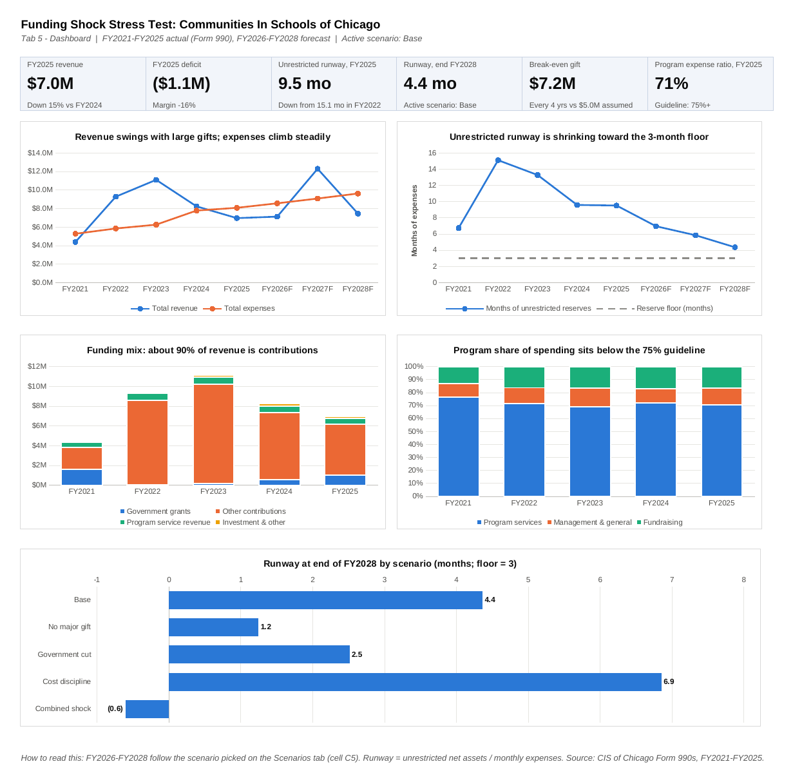
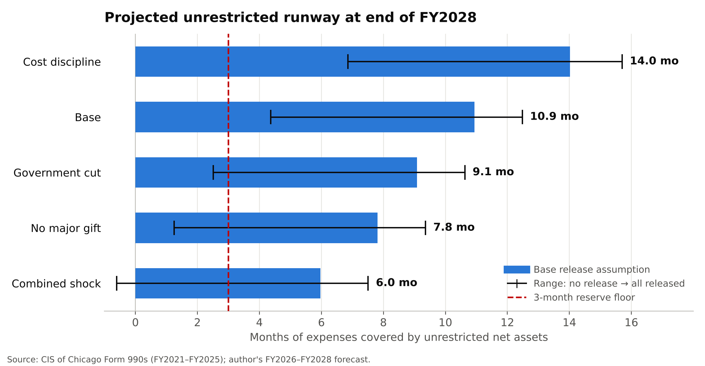

# Funding Shock Stress Test: Communities In Schools of Chicago

## Why I built this
I volunteer as a data science fellow at the Chicago Education Advocacy Cooperative (ChiEAC), which got me interested in how wraparound student-support organizations stay financially sustainable.

This started as a case study from ChiEAC's co-founder. I wanted to understand how organizations like CIS stay funded. What kept me digging was a mismatch: CIS's $12.9M of net assets looked comfortable, but half of it ($6.5M) was donor-restricted, mostly pledges not yet collected.

## The question
Communities In Schools (CIS) of Chicago connects students in 239 Chicago Public Schools with social, health and enrichment services through about 200 partner organizations. Its expenses rose every year from FY2021 to FY2025, while its revenue swung with large one-time gifts.

**Can CIS sustain its spending without new major gifts, and how long do its reserves last?**

**Who uses the answer:** the CIS board, executive director and major funders.

## The answer
**Not a near-term cash crunch, but a structural gap.** Unrestricted reserves stay above the 3-month floor through FY2028 in every scenario, largely because about **$5.3M of donor-restricted pledges** is released into operations. But recurring revenue falls **$1.1M–$2.2M a year** short of costs, so CIS needs about **$1.8M a year in one-time gifts** (about $7.2M every 4 years, 44% more than its ~$5M historical gift) just to stand still. Without new gifts, reserves would run out around **FY2031**.

## How I set it up
1. Pulled CIS of Chicago's Form 990s from ProPublica Nonprofit Explorer ([filing links](data/raw/FILING_LINKS.md)).
2. Put every line item used into CSV ([line items](data/raw/cis_chicago_990_line_items.csv), [summary](data/processed/cis_chicago_990_summary.csv)).
3. Ran tie-out checks on every year ([sources and checks](data/SOURCES.md)).
4. Built a 6-tab Excel model with a scenario dropdown ([workbook](excel-model/CIS_Chicago_FPA_Model.xlsx)).
5. Wrote a 1-page memo with findings and recommendations ([memo](reports/CIS_Chicago_Memo.pdf)).

## How I used it
**Recommendations:** hold cost growth near 3% (cuts the gift need to $1.3M a year), grow recurring unrestricted revenue, and manage reserves on an unrestricted, cash basis by tracking pledge collections. Details in the [memo](reports/CIS_Chicago_Memo.pdf).

## Key decisions and why
- **I measured runway on unrestricted net assets, not total net assets,** because half of the $12.9M in net assets ($6.5M) is donor-restricted, mostly pledges receivable ($6.4M).
- **I show a no-release → full-release range instead of a single runway,** because the timing of restricted releases isn't public and is the biggest swing factor.
- **I compared actual vs. actual (FY2025 vs FY2024) instead of budget vs. actual,** because CIS's budget isn't public.
- **I estimated major gifts from balance-sheet changes instead of picking a size,** because FY2023 pledges receivable rose $5.1M and restricted net assets rose $5.3M. Timing is irregular, so I also report the per-year need, the more robust figure.

## Key findings
- **Revenue depends on large, irregular gifts.** Contributions are ~89% of revenue, with large gifts in FY2019, FY2022 and FY2023. Revenue went $4.4M → $11.1M → $7.0M (FY2021–FY2025) while expenses rose every year, $5.3M → $8.1M.
- **The runway depends on restricted money reaching operations.** Unrestricted reserves cover 9.5 months, down from 15.1 in FY2022. Half of the $12.9M in net assets ($6.5M) is donor-restricted, mostly pledges receivable ($6.4M). In FY2025, releases lifted unrestricted net assets $191k despite a $1.1M deficit. This assumption is the biggest swing factor (see the range column below).
- **Efficiency has been below sector guidelines since FY2022.** Program services were 69–72% of spending in FY2022–FY2025 (76.6% in FY2021; guideline 75%+). The cost to raise $1 was $0.18 in FY2021, $0.10 in FY2023 and $0.22 in FY2025.

## Scenarios (FY2026–FY2028)
| Scenario | What changes | Runway, end FY2028 | Range: no release → all released | One-time gifts needed / yr |
|---|---|---|---|---|
| Base | Next $5M gift in FY2027 | 10.9 mo | 4.4 → 12.5 mo | $1.8M |
| No major gift | No new large gift | 7.8 mo | 1.2 → 9.4 mo | $1.8M |
| Government cut | Government grants fall 50% | 9.1 mo | 2.5 → 10.6 mo | $2.3M |
| Cost discipline | Expenses grow 3% instead of 6% | 14.0 mo | 6.9 → 15.7 mo | $1.3M |
| Combined shock | No gift and government cut | 6.0 mo | (0.6) → 7.5 mo | $2.3M |

Runway = unrestricted net assets ÷ monthly expenses. The base case releases existing restricted net assets down to $1.24M (the five-year low); the range shows no release and full release.

## Variance: what turned a surplus into a deficit (FY2024 → FY2025)
CIS's budget isn't public, so the comparison is FY2025 actual vs FY2024 actual.
- **It was mainly a revenue problem.** Revenue fell 15% ($1.3M), driven by non-government contributions (down $1.5M) as the large FY2022–FY2023 gifts rolled off. Government grants partly offset this (up $0.4M).
- **Costs grew only 3.8%.** Personnel rose $0.3M: 16 more staff (86 → 102) added about $1.2M (volume), offset by about $0.9M from a lower cost per employee ($75k → $66k, rate). The W-3 headcount includes part-year staff, so both effects may be overstated.
- **Management & general grew 25%**, the fastest of any cost line, while program services grew 1.8%.

## What worked, what didn't
**What worked:** every year passes the tie-out checks below, and key lines were verified by hand against the filings.

**What didn't (limitations):**
- Form 990s are published with a lag; FY2025 (year ended June 2025) is the latest available.
- The timing of restricted releases isn't public; the result is sensitive to it, so the range is shown.
- Major-gift size and timing are estimated from balance-sheet changes; the per-year need is the more robust figure.
- "Runs out around FY2031" holds the FY2028 deficit flat, so it is optimistic.
- Expenses grow at a single rate; "students served" is defined differently across years, so no per-student cost is calculated.

### What I'd do next
- Monthly cash forecast tied to pledge collections, using CIS's internal data, since $6.4M of pledges receivable drives the runway.
- Cost per student served, once CIS reports a consistent definition of "students served," to compare cost growth with program reach.

## Skills this shows
Liquidity runway analysis, scenario stress testing and restricted vs. unrestricted cash: the same questions a credit analyst asks about any borrower.

## What's inside
| Path | Contents |
|---|---|
| `excel-model/CIS_Chicago_FPA_Model.xlsx` | 6-tab model with live formulas and a scenario dropdown |
| `reports/CIS_Chicago_Memo.pdf` | 1-page memo: findings and recommendations |
| `data/raw/cis_chicago_990_line_items.csv` | Every Form 990 line used, FY2021–FY2025 |
| `data/raw/FILING_LINKS.md` | Links to each year's filing |
| `data/processed/cis_chicago_990_summary.csv` | Summary figures, FY2018–FY2025 |
| `data/SOURCES.md` | Sources, tie-out checks and known gaps |
| `images/dashboard.png` | Dashboard screenshot |
| `images/scenario_runway.png` | Scenario runway chart with the release range |

### The workbook
1. **Dashboard**: KPI tiles and five charts; forecast years follow the active scenario
2. **Inputs**: Form 990 data FY2021–FY2025 with automatic tie-out checks; base-case assumptions, each tagged *Filing* or *Assumption* with its rationale, including the restricted-release switch
3. **Historical**: growth, funding mix, spending ratios, runway (total vs. unrestricted), volatility
4. **Variance**: FY2025 vs FY2024 line by line, a personnel volume/rate split, and a bridge from the FY2024 surplus to the FY2025 deficit
5. **Forecast**: FY2026–FY2028 recurring revenue, a major-gift switch, structural vs. reported surplus, and an unrestricted/restricted net-asset roll-forward that ties to the reported surplus
6. **Scenarios**: dropdown (cell C5), all five scenarios side by side, break-even figures and the release range

**Colour key:** blue = number from a filing, yellow = key assumption you can change, black = formula, green = link from another tab.

## Key assumptions (base case)
| Assumption | Value | Source | Why |
|---|---|---|---|
| Non-government recurring giving growth | 3% / year | Assumption | Roughly inflation |
| Government grants | Flat at $989k | Assumption | Grew from $43k in three years; public funding uncertain |
| School service contracts | Flat at $560k | Filing trend | $557k–$719k for five years, no trend |
| Expense growth | 6% / year | Assumption | About half the 11% historical pace |
| Major gift | $5M every 4 years, released over 4 years | Filing evidence | FY2023 pledges receivable +$5.1M and restricted net assets +$5.3M; gifts also in FY2019 and FY2022, so timing is irregular |
| Existing restricted net assets | Released evenly FY2026–FY2028 down to $1.24M | Filing evidence | Mostly pledges receivable; $1.24M is the five-year low (FY2022) |
| Reserve floor | 3 months of expenses | Sector guideline | Common range is 3–6 months |

## Data and checks
All figures come from CIS of Chicago's e-filed Form 990s (via ProPublica Nonprofit Explorer). Each year passes tie-out checks: contributions lines sum to the total, revenue lines sum to total revenue, functional expenses sum across columns, restricted + unrestricted = total net assets, assets − liabilities = net assets, and each opening balance sheet matches the prior year's close. Key lines were also verified by hand against the filings.
